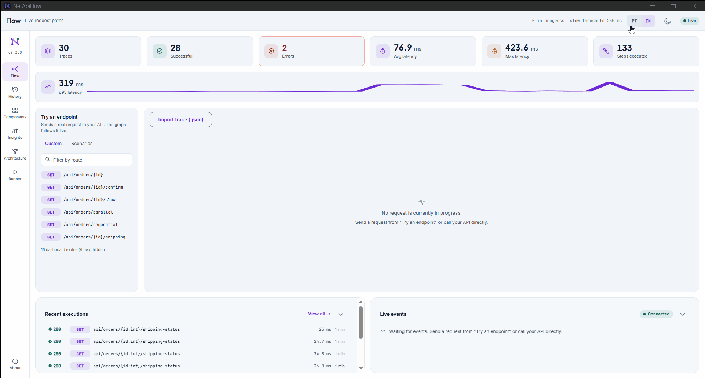

# NetApiFlow

See, live, the path every HTTP request takes through your own ASP.NET Core API: Controller/Endpoint → Handler → Services → Repositories → SQL, with per-step duration, where it failed, what was slow, and what never ran.

[](https://www.nuget.org/packages/NetApiFlow)
[](https://github.com/Douglasproglima/netapiflow/actions/workflows/ci.yml)
[](LICENSE)
[](https://dotnet.microsoft.com/)

🇧🇷 [Leia em português](README.pt-BR.md)



> The GIF above is recorded from `samples/SampleApi.Controllers` with the dashboard mounted.
> See [Quick start](#quick-start) to reproduce it yourself.

## What it is, and what it isn't

NetApiFlow instruments your own API's internal call path, not external latency, not
infrastructure metrics, not distributed tracing across services. It answers "where did *this*
request spend its time, inside *my* code" for a single ASP.NET Core process.

It is **not**:

- A distributed tracing system (no cross-service context propagation). NetApiFlow's own
  `ActivityListener` coexists peacefully with the OpenTelemetry SDK (see
  [`docs/adr/0002-activitysource-nativo-sem-otel-sdk.md`](docs/adr/0002-activitysource-nativo-sem-otel-sdk.md)),
  and `NetApiFlow.OpenTelemetry` exports its traces to any OTLP backend (see
  [OTLP export](#otlp-export)).
- An APM (no alerting, no dashboards beyond the one it ships, no long-term metrics storage
  beyond what you configure via a storage package).
- A profiler (it measures the steps you mark, not every method call in your process).

## Quick start

```bash
dotnet add package NetApiFlow
dotnet add package NetApiFlow.Dashboard
```

```csharp
using NetApiFlow;
using NetApiFlow.Dashboard;
using NetApiFlow.Dashboard.Endpoints;

var builder = WebApplication.CreateBuilder(args);
builder.Services.AddNetApiFlow();
builder.Services.AddNetApiFlowDashboard();

var app = builder.Build();
app.UseNetApiFlowDashboard(); // mounted at /flow by default
app.Run();
```

Open `http://localhost:<port>/flow` and send a request to any endpoint under your app. See
[Dashboard security in production](#dashboard-security-in-production) before deploying this
anywhere but your own machine.

## Marking forms

NetApiFlow needs to know where one step ends and the next begins. Pick whichever form fits each
layer. They compose freely in the same request.

| Form | What it does | When to use it |
|---|---|---|
| `NetApiFlow.Step(...)` | Manually opens and closes a step around a block of code | Any code, no dependency on DI |
| `AddFlowTracked<TInterface, TImpl>(...)` | Wraps every call to an interface's implementation in a step, via a dynamic proxy | A repository/service interface already registered in DI |
| `DecorateFlowTracked(predicate, ...)` | Same as above, applied in bulk to every registration matching a predicate | Many interfaces that share a naming convention (e.g. `I*Repository`) |
| `NetApiFlow.MediatR` | A pipeline behavior that wraps every `IRequest` handled by MediatR | Projects already using MediatR for commands/queries |
| `NetApiFlow.EntityFrameworkCore` | A `DbCommandInterceptor` that marks each SQL command as a `Database` step | Projects using EF Core |

Manual form, used explicitly:

```csharp
public async Task<Order?> FindAsync(int id, CancellationToken cancellationToken)
{
    using var step = NetApiFlow.Step(nameof(OrderRepository), nameof(FindAsync), ComponentType.Repository);
    return await _dbContext.Orders.FindAsync([id], cancellationToken);
}
```

Automatic form, from `samples/SampleApi.Controllers/Program.cs`: `OrderService`/`OrderRepository`
carry no NetApiFlow code at all, every call to them is tracked because of this one registration:

```csharp
using NetApiFlow.Marking;

builder.Services.AddFlowTracked<IOrderRepository, OrderRepository>(ComponentType.Repository);
builder.Services.AddFlowTracked<IOrderService, OrderService>(ComponentType.Service);
```

`DecorateFlowTracked` does the same thing in bulk, for every interface already registered in DI
whose implementation type matches a predicate. It scales to a real project with many repositories
and services, by naming convention instead of one call per interface:

```csharp
using NetApiFlow.Marking;

builder.Services.DecorateFlowTracked(type => type.Name.EndsWith("Repository"), ComponentType.Repository);
builder.Services.DecorateFlowTracked(type => type.Name.EndsWith("Service"), ComponentType.Service);
```

The predicate receives the concrete implementation type registered in DI, never the interface, so
matching on an interface-only naming convention (`IOrderRepository`) will not work.

### EF Core database commands

`NetApiFlow.EntityFrameworkCore` takes two steps, not one. `AddNetApiFlowEntityFrameworkCore()`
only registers `FlowDbCommandInterceptor` in DI. You attach it to each `DbContext` yourself,
because EF Core has no global interceptor registration:

```csharp
using NetApiFlow.EntityFrameworkCore;

builder.Services.AddNetApiFlowEntityFrameworkCore();

builder.Services.AddDbContext<AppDbContext>((sp, options) =>
{
    options.UseNpgsql(builder.Configuration.GetConnectionString("Default"));
    options.AddInterceptors(sp.GetRequiredService<FlowDbCommandInterceptor>());
});
```

### Tagging a step

A step opened with `NetApiFlow.Step(...)` accepts free key/value tags, recorded on that span:

```csharp
using var step = NetApiFlow.Step(nameof(OrderService), nameof(ConfirmAsync), ComponentType.Service);
step.Tag("order.status", order.Status);
step.Tag("payment.provider", provider.Name);
```

Call `Tag` at any point while the step is open, not only right after opening it: tags are read off
the step when it completes. A key starting with `netapiflow.` is reserved and never recorded.
`Limits.MaxTagsPerSpan` caps how many tags a span keeps (extra ones are discarded and counted),
and `Limits.MaxTagValueLength` truncates a long value without dropping the tag. Both are in
[Configuration](#configuration).

> **A tag value is never sanitized.** Every other field NetApiFlow records is either structural or
> passed through the error sanitizer. A tag is free text you chose to store, so it is persisted
> and served exactly as written. Keep it to identifiers and short labels, never a request payload,
> a user's data or a credential.

Tags travel on `FlowSpan.Tags`: `GET /traces/{traceId}`, `NetApiFlow.GetRecentTrace`,
`NetApiFlow.Mcp`'s `get_trace` and both storage packages all carry them. The dashboard UI does not
display them in this version.

## Asserting on flow in tests

An integration test built on `WebApplicationFactory<TEntryPoint>` already has the response its
own request just produced. `NetApiFlow.GetRecentTrace` reads that trace straight from the
in-memory buffer kept while persistence catches up, so there's no `Task.Delay` or retry loop
waiting for the asynchronous write to finish:

```csharp
public class OrdersEndpointTests(WebApplicationFactory<Program> factory)
    : IClassFixture<WebApplicationFactory<Program>>
{
    [Fact]
    public async Task GetOrder_DoesNotTriggerMoreThanOneDatabaseQuery()
    {
        var client = factory.CreateClient();

        var response = await client.GetAsync("/api/orders/42");

        var traceId = response.Headers.GetValues("X-NetApiFlow-TraceId").Single();
        var trace = NetApiFlow.GetRecentTrace(factory.Services, traceId);

        Assert.NotNull(trace);
        Assert.Equal(1, trace.Spans.Count(s => s.Type == ComponentType.Database));
    }
}
```

`GetRecentTrace` returns a plain `FlowTraceDetail` (the `FlowTrace` and the `FlowSpan`s it
recorded), not an assertion DSL: query `trace.Spans` with whatever LINQ expresses the rule
("no more than N database calls", "this route never calls that repository", "no step failed")
and whatever assertion library the test project already uses, xUnit's own `Assert` included.
It returns `null` when the trace already aged out of the in-memory buffer (500 traces completed
between the call and the assertion) or when NetApiFlow was never registered, never when the HTTP
call itself failed.

## Optional packages

| Package | Adds |
|---|---|
| [`NetApiFlow.Dashboard`](https://www.nuget.org/packages/NetApiFlow.Dashboard) | The REST/SSE API and the embedded Angular UI |
| [`NetApiFlow.MediatR`](https://www.nuget.org/packages/NetApiFlow.MediatR) | Automatic tracking of MediatR requests |
| [`NetApiFlow.EntityFrameworkCore`](https://www.nuget.org/packages/NetApiFlow.EntityFrameworkCore) | Tracking of EF Core database commands, once the interceptor is attached to your `DbContext` |
| [`NetApiFlow.Storage.PostgreSql`](https://www.nuget.org/packages/NetApiFlow.Storage.PostgreSql) | Persists traces to PostgreSQL instead of memory |
| [`NetApiFlow.Storage.SqlServer`](https://www.nuget.org/packages/NetApiFlow.Storage.SqlServer) | Persists traces to SQL Server instead of memory |
| [`NetApiFlow.Mcp`](https://www.nuget.org/packages/NetApiFlow.Mcp) | A read-only MCP server so an AI agent can query traces directly |
| [`NetApiFlow.OpenTelemetry`](https://www.nuget.org/packages/NetApiFlow.OpenTelemetry) | Exports traces to any OTLP backend (Jaeger, Tempo, Aspire Dashboard, Honeycomb, a collector) |

The core (`NetApiFlow`) has zero dependencies beyond the ASP.NET Core shared framework. Every
one of the above is opt-in.

## Reading the graph

Every node is one step. Color reinforces its state, but never is the only signal: each state
also has a distinct icon and text label, so the graph stays legible to color blindness or a
black-and-white printout.

| State | Meaning |
|---|---|
| ⏳ Waiting | Inferred from a previous successful execution of this endpoint (the "blueprint"); the current request hasn't reached this step yet |
| ▶ Running | Currently executing |
| ✓ Completed | Finished without error, under the slow threshold |
| ⚠ Slow | Finished without error, at or above the configured slow threshold |
| ✕ Error | Finished with an exception, or a descendant step failed |
| ∅ Not executed | The blueprint expected this step, but the request finished without reaching it (e.g. an early return, a short-circuited branch) |

A `Database` node also shows an N+1 badge, e.g. `⚠ ×12`, when 3 or more `Database` steps in the
same trace share the same component and operation, even under different parents. That shape is
what a classic N+1 loop produces: one query per loop iteration, same SQL format, different
instance of the step in the loop.

A finished trace also shows how much of its total duration isn't covered by any recorded step,
e.g. "30% of the time (55 ms of 183 ms) is not covered by any recorded step." The math is the
union of every step's `[startedAt, endedAt)` interval, not a naive sum of durations, so a nested
step or two parallel branches of a `Task.WhenAll` never get counted twice.

The same six states are listed in a fixed legend in the bottom-left corner of the canvas, so you
never have to recall what an icon means. The bottom-right corner has zoom in, zoom out and "fit to
screen" buttons plus the current zoom percentage. Wheel, drag and pinch keep working as before.
The buttons just make the same zoom reachable without a gesture.

While a trace is still running, a "Pause live" button appears in the graph's header. Pausing
freezes the graph where it is, so you can inspect a step without the picture moving under you.
Events arriving meanwhile are queued, not dropped, and "Resume live" applies the whole backlog in
order. It is a different thing from Replay: pausing stays on the running trace, Replay steps
through a trace that already finished.

The metrics strip above the graph carries a p95 latency card with a sparkline of the last 50
executions. The p95 figure comes from `GET /metrics` for the whole window. The sparkline is the
shape of the recent series next to it. Both refresh as traces complete.

## Try an endpoint

"Try an endpoint" (in the top bar on `/flow`, or the `/runner` page) sends a real request to your
API from the dashboard, so the graph has something to draw without you leaving the browser or
reaching for a REST client.

The "Custom" tab builds its form from your application's own OpenAPI document: pick an endpoint,
fill in path and query parameters and a JSON body, send. It needs `MapOpenApi()` (or an equivalent
OpenAPI endpoint) in the host application, and says so when the document can't be loaded. The
dashboard's own routes are filtered out of the list.

The "Scenarios" tab is four one-click requests built for the bundled samples: Success, Slow,
Error and Sequential (N+1), each one producing a trace with a distinct shape. They target the
routes in `samples/SampleApi.Controllers` and `samples/SampleApi.MinimalMediatR`, so they are
there to demo the dashboard, not to exercise your own API: use the "Custom" tab for that.

The same tab has an artificial delay selector (none, 250 ms, 1000 ms, 3000 ms) applied to the
scenario before it is sent, to produce a believably slow trace without real load. The delay is
sent as an `X-NetApiFlow-Demo-Delay-Ms` request header and only has an effect if the host honors
it. Honoring it is sample code (`DemoDelayMiddleware` in both sample projects), not part of any
published package: NetApiFlow never delays a request of yours.

## Export and import a trace

A trace on `/flow` can be downloaded as a `.json` file ("Download trace (.json)") and opened again
in any other dashboard instance ("Import trace (.json)"). Both happen entirely in the browser:
exporting serializes the trace already in memory, importing reads the file locally, and neither
makes an HTTP call in either direction. The person receiving the file needs no access to the API
that produced it, nor to its database, which is what makes a trace mailable to a colleague or
pastable into a conversation with an AI agent.

An imported trace renders through exactly the same graph, waterfall, metric cards and event feed
as a live one, carries a visible "Imported trace" badge for as long as it is open, and has a
"Back to live traces" action to leave. It is never persisted: it does not enter `ITraceStore` and
never shows up in `/history`, `/insights`, `/metrics` or `/architecture`, so someone else's trace
can't contaminate your own statistics. A file that isn't a NetApiFlow export gets a clear error
message, never a blank screen.

Clicking a span of an imported trace builds its ancestors and children from the file itself, with
no round trip. That span detail has no median duration and no delta from the median: those come
from previous executions of the same operation, and the instance reading the file has no history
for a trace it never recorded.

## Compare two executions

Two executions of the same route can be compared side by side. On `/history`, select exactly two
rows and press "Compare". That opens `/diff?a=<traceIdA>&b=<traceIdB>`, a shareable URL for as
long as both executions still exist in the `ITraceStore` of whoever opens it.

Steps are matched by component and operation, never by span id (a span id is unique to one
execution and never repeats across two). A step repeated within one execution, which is what an
N+1 loop produces, is summed into a single row showing the count on each side, instead of filling
the table with near-identical rows. A step that only one of the two executions ran shows as "not
executed" on the other side, with the same icon and label the graph already uses, never as a
matched step with zero duration. Matched steps show the duration of each side and the delta
between them.

Comparing two executions of different routes still works, every step simply lands on one side
only. The page flags it as a warning, since that's rarely what you meant.

## Dashboard preferences

The dashboard UI defaults to Portuguese (pt-BR); switch to English from the language toggle in
the top bar. It also follows your OS's light/dark preference automatically, with a manual
override next to the language toggle. Both choices persist across reloads; the displayed package
version always comes from a live `GET /config` call, so it matches whatever's actually installed.

In the history list (`/history`), every column header sorts the whole result set server-side, not
just the current page. Combine "slow only" with sorting by Duration (descending) to get the
slowest executions across the entire history.

## Insights

`/insights` is an aggregated view across every traceable route of the host API, for a chosen time
window (last 24 hours, last 7 days by default, or last 30 days): the slowest routes by p95
duration, the routes with the most errors, and dead routes, those that exist in the host API but
never ran in the chosen window. All three come from `GET /metrics/routes` and `GET /endpoints`;
slowest and top errors are two different sortings of the same payload, and dead routes is the
dashboard cross-referencing it against every route the host API exposes.

## Architecture map

`/architecture` is the static call graph of a single route (HTTP method and route template),
built from every execution recorded within a chosen time window, not just the last one: the same
question `/blueprint` answers from one trace ("what does this route normally do"), generalized to
the whole window. Pick a route and a window; a step that didn't run on every execution shows its
occurrence percentage right in its label (e.g. `TryGetAsync (14%)`), so a conditional path like a
cache hit stands out. Export the graph as Mermaid or SVG, both generated in the browser from the
data already loaded, no extra request.

> **The map reflects what was persisted, not necessarily every real execution.** With tail
> sampling (below) enabled and a low `SuccessSampleRate`, most persisted executions of a route are
> its errors and slow runs, so the map skews toward that path instead of the typical successful
> one. Expected consequence of sampling, not a bug.

## Configuration

```csharp
builder.Services.AddNetApiFlow(options =>
{
    options.Enabled = true; // master switch; false skips every check at near-zero cost
    options.SlowThreshold = TimeSpan.FromMilliseconds(250);
    options.CaptureSqlText = false; // never captures parameter values, only enables the SQL text itself
    options.Retention.MaxTraces = 1000;
    options.Retention.MaxAge = TimeSpan.FromHours(24);
    options.Limits.MaxSpansPerTrace = 300;
    options.Limits.MaxTagsPerSpan = 20; // default shown; extra tags are discarded and counted
    options.Limits.MaxTagValueLength = 4000; // default shown; a longer value is truncated, not dropped
    options.IncludePaths("/api/**"); // only trace matching routes; default traces everything
    options.ExcludePaths("/api/health"); // excluded even if it also matches an include pattern
    options.ExternalSources = ExternalActivitySource.HttpClient | ExternalActivitySource.Npgsql; // opt-in; default is None
    options.CapturePrePipelineSteps = true; // opt-in; default is false, see below
    options.TailSampling.Enabled = true; // opt-in; see Tail sampling below
    options.TailSampling.SuccessSampleRate = 0.1; // default shown
    options.LogCorrelation.Enabled = true; // opt-in; see Log correlation below
    options.Limits.MaxLogEntriesPerSpan = 20; // default shown
    options.OpenApiDocumentPath = "/swagger/v1/swagger.json"; // default is /openapi/v1.json
});
```

`OpenApiDocumentPath` tells the dashboard's "Run an endpoint" panel where your application serves
its OpenAPI document. The default is what `MapOpenApi()` serves. Point it at
`/swagger/v1/swagger.json` for Swashbuckle, or wherever else you serve it. The panel lists your
endpoints from that document, so a wrong path leaves it with nothing to show.

`CapturePrePipelineSteps` records what runs before your controller is even called, on MVC
Controller routes: one step per Authorization filter, under the component `AuthorizationFilters`
with the filter's type name as its operation, and one step around the Resource filter stage,
under the component `ResourceFilters` with the action name as its operation. The latter becomes
the parent of the `Controller` step already in the graph, so the stages nest instead of
duplicating. That's the answer to "the request took 400 ms but my controller only took
20 ms, where did the rest go" when the time went to authorization or to a resource filter such as
output caching. It is off by default and changes nothing for anyone who hasn't turned it on.
Minimal API routes have no MVC filter stage, so they see no new step either way.

`ExternalSources` ingests the `Activity` instances the .NET runtime and the Npgsql driver already
produce, with no code change in your services.

`HttpClient` covers outbound calls (ADR-0012). The outbound URL is reduced to
`scheme://host[:port]/path` before it is ever recorded: query string and fragment are never
captured, same guarantee as every other span.

`Npgsql` covers SQL commands (ADR-0018), recorded as a `Database` span named after the command
type and the main table it touches, for example `SELECT Users`. When you also use
`NetApiFlow.EntityFrameworkCore`, the two never record the same command twice: the driver's own
`Activity` is dropped whenever a NetApiFlow step already wraps the call, which is exactly what
`FlowDbCommandInterceptor` does. Without that package (plain Npgsql, or Dapper over Npgsql), the
driver's `Activity` is the only record of the call and is ingested normally. The full SQL text
only reaches the span when `CaptureSqlText` is enabled, the same rule the EF Core interceptor
follows.

Mounting the dashboard at a path other than the default, and protecting it:

```csharp
app.UseNetApiFlowDashboard("/internal/flow")
    .RequireAuthorization("AdminOnly"); // or register an IFlowAccessFilter in DI
```

Persisting to a real database instead of memory (call after `AddNetApiFlow`, it replaces the
default store):

```csharp
builder.Services.AddNetApiFlowPostgreSqlStorage(
    connectionString,
    options => options.TablePrefix = "netapiflow_"); // default shown
```

`NetApiFlow.Storage.SqlServer` mirrors the same shape (`AddNetApiFlowSqlServerStorage`).

## Dashboard security in production

> **The dashboard shows internal implementation details of your API: component names, operation
> names, SQL table names, error messages.** Treat its exposure with the same care as any other
> internal diagnostics endpoint.
>
> Outside `IHostEnvironment.IsDevelopment()`, every dashboard route (REST, SSE and the UI itself)
> responds **404** unless you explicitly configure one of:
>
> - `.RequireAuthorization("YourPolicy")`, chained on `app.UseNetApiFlowDashboard(...)`.
> - A custom `IFlowAccessFilter` registered in DI, checked on every request
>   regardless of environment.
>
> There is no "partially open" default. If neither is configured, production always 404s.

## MCP server

```bash
dotnet add package NetApiFlow.Mcp
```

```csharp
builder.Services.AddNetApiFlowMcp();

var app = builder.Build();
app.UseNetApiFlowMcp(); // mounted at /flow/mcp by default
```

Three read-only tools, backed by the same `ITraceStore` the dashboard reads from: `list_recent_traces`,
`get_trace` and `get_component_stats`. No write tool exists in this version: nothing deletes a
trace or triggers a replay through MCP.

> **Same security rule as the dashboard.** Outside `IHostEnvironment.IsDevelopment()`, every MCP
> route responds **404** unless you explicitly configure `.RequireAuthorization(...)` or a custom
> `IFlowAccessFilter`, exactly like [Dashboard security in production](#dashboard-security-in-production).
> An AI agent reading trace data is the same exposure risk as the visual dashboard.

See `samples/SampleApi.Controllers/README.md` for how to point a real MCP client (e.g. Claude
Code) at a running instance.

## OTLP export

```bash
dotnet add package NetApiFlow.OpenTelemetry
```

```csharp
builder.Services.AddNetApiFlowOtlpExport();
```

The NetApiFlow core already produces real `Activity` instances on the `"NetApiFlow"`
`ActivitySource` (ADR-0002). `AddNetApiFlowOtlpExport` points the OpenTelemetry SDK at that
source and exports it via OTLP, to any compatible backend: Jaeger, Tempo, Aspire Dashboard,
Honeycomb, or an OpenTelemetry Collector. There is no NetApiFlow-specific serialization: the SDK
exports the same `Activity` the dashboard reads from.

```csharp
builder.Services.AddNetApiFlowOtlpExport(options =>
{
    options.IncludeHttpClientSource = true; // default: false, see the warning below
    options.ConfigureOtlpExporter = otlp => otlp.Endpoint = new Uri("http://localhost:4317");
});
```

> **`IncludeHttpClientSource` exports the full outbound URL, including query string.** Enabling
> it also observes the native `"System.Net.Http"` `ActivitySource`, mirroring
> `NetApiFlowOptions.ExternalSources` so the exported trace has the same outbound HTTP spans the
> dashboard shows. That native `Activity` never passes through NetApiFlow's own URL sanitizer
> (which only sanitizes `FlowSpan`), so the OTLP backend receives the URL as-is. Default is
> `false` for this reason.

> **Exported volume can exceed what the dashboard shows.** The OpenTelemetry SDK samples
> independently of NetApiFlow's own sampling decision (tracing disabled, the 500-trace limit
> reached). A request NetApiFlow discards early can still be exported. Neither pipeline blocks
> the other; this is the expected result of two independent `ActivityListener` instances
> observing the same source, not a bug.

## Tail sampling

```csharp
builder.Services.AddNetApiFlow(options =>
{
    options.TailSampling.Enabled = true; // default: false, every completed trace is persisted
    options.TailSampling.SuccessSampleRate = 0.1; // default shown, keep 10% of the rest
});
```

Disabled by default: every completed trace is persisted, same as before this option existed.
Enabled, the decision is made once, when a trace is ready to persist, before it ever reaches the
`ITraceStore`:

- A trace with an error is always persisted.
- A trace at or above `SlowThreshold` is always persisted (the same threshold already used to
  color the UI, not a second concept of "slow").
- Any other trace (successful, not slow) is persisted with probability `SuccessSampleRate`.

> **The live view never changes.** `GET /traces/live` and the SSE stream read from the in-memory
> recorder, not from the store, so a sampled-out trace still shows up while it runs. Only the
> persisted history is affected.

> **`/blueprint`, `/architecture` and the aggregated metrics reflect the sample, not the real
> traffic, once enabled.** A low `SuccessSampleRate` can leave `/blueprint` without a recent
> successful trace to replay, skews `/architecture` toward the error and slow executions that are
> always kept, and `/metrics`, `/metrics/components` and `/metrics/routes` count only what was
> kept. This is the expected result of sampling, not a bug. `GET /config` exposes the current
> state so `/history` shows a visible banner whenever tail sampling is on.

## Log correlation

```csharp
builder.Services.AddNetApiFlow(options =>
{
    options.LogCorrelation.Enabled = true; // default: false
    options.LogCorrelation.MinLevel = LogLevel.Warning; // default shown
});
```

Disabled by default. Enabled, every `ILogger` call made at or above `MinLevel` while a `FlowStep`
is active is correlated to that span's `Logs`, right next to its error, no second tool to open to
see what the application logged while that step ran. The mechanism is a second `ILoggerProvider`,
registered alongside whatever providers your app already has (Console, Serilog, Application
Insights, etc.): it never replaces or filters them, logging to your usual destinations keeps
working exactly as before. A log call outside a tracked step (startup, an uninstrumented
background job) is never observed by this provider.

> **Sanitization here is the same best-effort regex already used for `FlowStep.MarkError`, not a
> new or stronger guarantee.** A log message is free text your own code writes, and can in
> principle contain anything, including data the regex-based sanitizer doesn't recognize. This is
> why the feature defaults to off and `MinLevel` defaults to `Warning`: lower the blast radius
> before you decide the trade-off is worth it for your application.

## Sensitive data

NetApiFlow never captures, under any configuration:

- Request or response bodies.
- Method arguments or return values.
- Headers or query strings (routes are always recorded as templates, e.g. `/api/orders/{id}`,
  never the resolved URI).
- SQL parameter values, even with `CaptureSqlText = true` (that flag only captures the command
  text and the main table it touches).
- Query strings or fragments of outbound URLs, when `ExternalSources` is enabled (same reduction
  to `scheme://host[:port]/path` as routes).
- Connection string, database user or peer address, when `ExternalActivitySource.Npgsql` is
  enabled. The driver reports all of them on its own `Activity`; none is ever copied onto a span.

> **A request that never matches a route is recorded as `(unmatched)`, never its real path.** A
> 404 on a typo'd URL and a successful request to a static file both land in history as
> `(unmatched)`, indistinguishable from each other. That's the same template guarantee above, just
> for the case where there's no template to use yet. If static assets or your own OpenAPI document
> are cluttering your history with `(unmatched)` noise, `ExcludePaths` keeps them out of tracing
> entirely.

Error messages are truncated to 300 characters and sanitized, removing e-mail addresses, CPF,
CNPJ, long numeric sequences, and `password=`/`token=`/`authorization`/`api-key`/`secret` pairs.
See [`docs/adr/0007-nunca-capturar-payload.md`](docs/adr/0007-nunca-capturar-payload.md).

The one exception is what you write yourself: a step's tags (see
[Tagging a step](#tagging-a-step)) are stored and served exactly as given, with no sanitization.

## Performance and overhead

Measured with `tests/NetApiFlow.Benchmarks` (BenchmarkDotNet), comparing the cost of a request
against a minimal ASP.NET Core pipeline with NetApiFlow **absent** (package not installed),
**disabled** (`Enabled = false`) and **enabled** (default options), on two endpoints: `Simple`
(no steps marked) and `Nested` (four nested `NetApiFlow.Step` calls, mirroring a
Controller→Service→Repository→Database chain).

| Scenario | Simple (mean) | Nested, 4 steps (mean) |
|---|---|---|
| Absent (package not installed) | 6.22 μs | 11.79 μs |
| Disabled (`Enabled = false`) | 9.17 μs | 12.84 μs |
| Enabled (default options) | 27.00 μs | 43.84 μs |

So tracing a request with default options costs roughly 20 μs on an endpoint with no steps
marked, and about 32 μs more with four nested steps, on this hardware. Turning tracing off
(`Enabled = false`) keeps most of that cost away (listener registration itself has a small,
near-constant overhead) without removing the package.

Method: each scenario (absent/disabled/enabled) runs as its own process, isolating .NET's
process-wide `ActivitySource` listener registration so one scenario can't bias another. Full
BenchmarkDotNet reports, including hardware and runtime details, are generated under
`tests/NetApiFlow.Benchmarks/BenchmarkDotNet.Artifacts/results/` on every run.

## Known limitations

- `Activity.Current` (and therefore step nesting) is lost across `ExecutionContext.SuppressFlow()`
  or a custom, non-flowing thread pool. Spans created after such a boundary record correctly, but
  as a new root rather than nested under the request's trace.
- Automatic tracking (`AddFlowTracked`/`DecorateFlowTracked`) does not support `IAsyncEnumerable<T>`
  return types in this version.
- `net9.0` (STS) is not a supported target. Multi-targeting covers `net8.0` and `net10.0` (both
  LTS); a `net9.0` consumer resolves to the `net8.0` asset, including the hand-written SSE
  implementation used there instead of `net10.0`'s native `TypedResults.ServerSentEvents`.

## Contributing

Issues and pull requests are welcome. This project follows Conventional Commits and Gitflow. See
`docs/gitflow.md` if you're sending a PR.

## Support

NetApiFlow is free and open source. If it saved you time, consider buying the author a coffee:
PIX key `douglasproglima@gmail.com`.

## License

MIT. See [LICENSE](LICENSE).

## Inspiration

NetApiFlow is inspired by the idea behind [apiflow](https://github.com/joshuamaia/apiflow) (Spring
Boot): visualizing a request's path through an API in real time. No code, file or asset from
that project was copied or ported. Everything here is written from scratch, for .NET.
