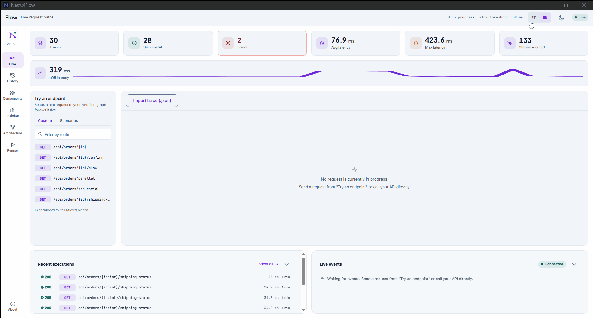

# NetApiFlow

Veja, ao vivo, o caminho que cada requisição HTTP percorre dentro da sua própria API ASP.NET Core: Controller/Endpoint, Handler, Services, Repositories, SQL. Com duração de cada etapa, onde ela falhou, o que ficou lento e o que nunca chegou a rodar.

[](https://www.nuget.org/packages/NetApiFlow)
[](https://github.com/Douglasproglima/netapiflow/actions/workflows/ci.yml)
[](LICENSE)
[](https://dotnet.microsoft.com/)

🇺🇸 [Read in English](README.md)



> O GIF acima foi gravado a partir de `samples/SampleApi.Controllers` com o dashboard montado.
> Veja [Início rápido](#início-rápido) para reproduzir você mesmo.

## O que é, e o que não é

O NetApiFlow instrumenta o caminho de chamadas interno da sua própria API, não latência externa,
não métrica de infraestrutura, não tracing distribuído entre serviços. Ele responde "onde *esta*
requisição gastou tempo, dentro do *meu* código", para um único processo ASP.NET Core.

Ele **não é**:

- Um sistema de tracing distribuído (sem propagação de contexto entre serviços, sem exportação
  OTLP). Se você precisa disso, use OpenTelemetry. O `ActivityListener` próprio do NetApiFlow
  convive bem com ele, sem conflito (veja
  [`docs/adr/0002-activitysource-nativo-sem-otel-sdk.md`](docs/adr/0002-activitysource-nativo-sem-otel-sdk.md)).
- Um APM (sem alerta, sem dashboard além do que ele mesmo entrega, sem armazenamento de métrica de
  longo prazo além do que você configurar via um pacote de storage).
- Um profiler (ele mede as etapas que você marca, não cada chamada de método do processo).

## Início rápido

```bash
dotnet add package NetApiFlow
dotnet add package NetApiFlow.Dashboard
```

```csharp
var builder = WebApplication.CreateBuilder(args);
builder.Services.AddNetApiFlow();
builder.Services.AddNetApiFlowDashboard();

var app = builder.Build();
app.UseNetApiFlowDashboard(); // montado em /flow por padrão
app.Run();
```

Abra `http://localhost:<porta>/flow` e envie uma requisição para qualquer endpoint da sua
aplicação. Veja [Segurança do dashboard em produção](#segurança-do-dashboard-em-produção) antes
de publicar isso em qualquer lugar além da sua própria máquina.

## Formas de marcar etapas

O NetApiFlow precisa saber onde uma etapa termina e a próxima começa. Escolha a forma que couber
em cada camada. Elas se combinam livremente na mesma requisição.

| Forma | O que faz | Quando usar |
|---|---|---|
| `NetApiFlow.Step(...)` | Abre e fecha uma etapa manualmente em volta de um trecho de código | Qualquer código, sem depender de DI |
| `AddFlowTracked<TInterface, TImpl>(...)` | Envolve toda chamada à implementação de uma interface numa etapa, via proxy dinâmico | Uma interface de repositório/serviço já registrada no DI |
| `DecorateFlowTracked(predicate, ...)` | O mesmo de cima, aplicado em lote a todo registro que bater com um predicado | Muitas interfaces que seguem uma convenção de nome (ex.: `I*Repository`) |
| `NetApiFlow.MediatR` | Um pipeline behavior que envolve todo `IRequest` tratado pelo MediatR | Projetos que já usam MediatR para comandos/queries |
| `NetApiFlow.EntityFrameworkCore` | Um `DbCommandInterceptor` que marca cada comando SQL como uma etapa `Database` | Projetos que usam EF Core |

Forma manual, usada explicitamente:

```csharp
public async Task<Order?> FindAsync(int id, CancellationToken cancellationToken)
{
    using var step = NetApiFlow.Step(nameof(OrderRepository), nameof(FindAsync), ComponentType.Repository);
    return await _dbContext.Orders.FindAsync([id], cancellationToken);
}
```

Forma automática, de `samples/SampleApi.Controllers/Program.cs`. `OrderService`/`OrderRepository`
não têm nenhum código do NetApiFlow. Toda chamada a eles é rastreada só por causa deste registro:

```csharp
builder.Services.AddFlowTracked<IOrderRepository, OrderRepository>(ComponentType.Repository);
builder.Services.AddFlowTracked<IOrderService, OrderService>(ComponentType.Service);
```

## Pacotes opcionais

| Pacote | Acrescenta |
|---|---|
| [`NetApiFlow.Dashboard`](https://www.nuget.org/packages/NetApiFlow.Dashboard) | A API REST/SSE e a UI Angular embutida |
| [`NetApiFlow.MediatR`](https://www.nuget.org/packages/NetApiFlow.MediatR) | Rastreamento automático de requests do MediatR |
| [`NetApiFlow.EntityFrameworkCore`](https://www.nuget.org/packages/NetApiFlow.EntityFrameworkCore) | Rastreamento automático de comandos de banco do EF Core |
| [`NetApiFlow.Storage.PostgreSql`](https://www.nuget.org/packages/NetApiFlow.Storage.PostgreSql) | Persiste traces no PostgreSQL em vez de memória |
| [`NetApiFlow.Storage.SqlServer`](https://www.nuget.org/packages/NetApiFlow.Storage.SqlServer) | Persiste traces no SQL Server em vez de memória |
| [`NetApiFlow.Mcp`](https://www.nuget.org/packages/NetApiFlow.Mcp) | Um servidor MCP só leitura para um agente de IA consultar traces direto |

O núcleo (`NetApiFlow`) não tem nenhuma dependência além do shared framework do ASP.NET Core.
Cada item acima é opcional.

## Como ler o grafo

Cada nó é uma etapa. A cor reforça o estado, mas nunca é o único sinal: cada estado também tem um
ícone e um texto próprios, para o grafo continuar legível para quem tem daltonismo ou numa
impressão em preto e branco.

| Estado | Significado |
|---|---|
| ⏳ Aguardando | Inferido de uma execução bem-sucedida anterior deste endpoint (o "blueprint"); a requisição atual ainda não chegou nesta etapa |
| ▶ Em execução | Executando agora |
| ✓ Concluído | Terminou sem erro, abaixo do limiar de lentidão |
| ⚠ Lento | Terminou sem erro, no limiar configurado de lentidão ou acima dele |
| ✕ Erro | Terminou com exceção, ou uma etapa descendente falhou |
| ∅ Não executado | O blueprint esperava esta etapa, mas a requisição terminou sem alcançá-la (ex.: um retorno antecipado, um ramo que nunca foi seguido) |

Um nó `Database` também mostra um selo de N+1, por exemplo `⚠ ×12`, quando 3 ou mais etapas
`Database` do mesmo trace compartilham o mesmo componente e a mesma operação, mesmo sob pais
diferentes. É essa a forma que um N+1 clássico produz. Uma consulta por iteração do laço, mesmo
formato de SQL, cada uma filha de uma instância diferente da etapa em loop.

Um trace concluído também mostra quanto da sua duração total não está coberto por nenhuma etapa
registrada, por exemplo "30% do tempo (55 ms de 183 ms) não está coberto por nenhuma etapa
registrada". A conta é a união dos intervalos `[startedAt, endedAt)` de cada etapa, não uma soma
ingênua das durações. Assim, uma etapa aninhada ou duas branches paralelas de um `Task.WhenAll`
nunca são contadas em dobro.

## Preferências do dashboard

A interface do dashboard vem em português (pt-BR) por padrão. Troque para inglês pelo seletor de
idioma na barra superior. Ela também segue a preferência clara/escura do sistema automaticamente,
com um alternador manual ao lado do seletor de idioma. As duas escolhas sobrevivem a um
recarregamento. A versão do pacote mostrada vem sempre de uma chamada real a `GET /config`, então
bate com o que está instalado de fato.

Na listagem do histórico (`/history`), cada cabeçalho de coluna ordena o resultado inteiro no
servidor, não só a página atual. Combine "Só lentas" com ordenar por Duração (decrescente) para
ver as execuções mais lentas de todo o histórico.

## Configuração

```csharp
builder.Services.AddNetApiFlow(options =>
{
    options.Enabled = true; // chave geral; false pula toda checagem a custo quase zero
    options.SlowThreshold = TimeSpan.FromMilliseconds(250);
    options.CaptureSqlText = false; // nunca captura valor de parâmetro, só habilita o texto do SQL em si
    options.Retention.MaxTraces = 1000;
    options.Retention.MaxAge = TimeSpan.FromHours(24);
    options.Limits.MaxSpansPerTrace = 300;
    options.IncludePaths("/api/**"); // só rastreia rota que bater; por padrão rastreia tudo
    options.ExcludePaths("/api/health"); // excluída mesmo que também bata com um padrão de inclusão
    options.ExternalSources = ExternalActivitySource.HttpClient; // opt-in; padrão é None
});
```

`ExternalSources` ingere a `Activity` que o próprio runtime .NET já produz para chamada de saída
(ADR-0012), sem nenhuma mudança de código nos seus serviços. Só `HttpClient` é suportado hoje. A
URL de saída é reduzida a `scheme://host[:porta]/path` antes de ser gravada. Query string e
fragment nunca são capturados, a mesma garantia de qualquer outro span.

Montando o dashboard num caminho diferente do padrão, e protegendo-o:

```csharp
app.UseNetApiFlowDashboard("/internal/flow")
    .RequireAuthorization("AdminOnly"); // ou registre um IFlowAccessFilter no DI
```

Persistindo num banco de verdade em vez de memória (chamar depois de `AddNetApiFlow`, substitui o
storage padrão):

```csharp
builder.Services.AddNetApiFlowPostgreSqlStorage(
    connectionString,
    options => options.TablePrefix = "netapiflow_"); // valor padrão mostrado
```

`NetApiFlow.Storage.SqlServer` espelha a mesma forma (`AddNetApiFlowSqlServerStorage`).

## Segurança do dashboard em produção

> **O dashboard mostra detalhe interno de implementação da sua API: nome de componente, nome de
> operação, nome de tabela SQL, mensagem de erro.** Trate a exposição dele com o mesmo cuidado de
> qualquer outro endpoint de diagnóstico interno.
>
> Fora de `IHostEnvironment.IsDevelopment()`, toda rota do dashboard (REST, SSE e a própria UI)
> responde **404**, a menos que você configure explicitamente um dos dois:
>
> - `.RequireAuthorization("SuaPolicy")`, encadeado em `app.UseNetApiFlowDashboard(...)`.
> - Um `IFlowAccessFilter` próprio registrado no DI, checado em toda requisição,
>   independente do ambiente.
>
> Não existe padrão "parcialmente aberto". Sem nenhum dos dois configurados, produção sempre
> devolve 404.

## Servidor MCP

```bash
dotnet add package NetApiFlow.Mcp
```

```csharp
builder.Services.AddNetApiFlowMcp();

var app = builder.Build();
app.UseNetApiFlowMcp(); // montado em /flow/mcp por padrão
```

Três tools só leitura, sobre o mesmo `ITraceStore` que o dashboard lê: `list_recent_traces`,
`get_trace` e `get_component_stats`. Nenhuma tool de escrita existe nesta versão. Nada apaga um
trace nem dispara um replay via MCP.

> **Mesma regra de segurança do dashboard.** Fora de `IHostEnvironment.IsDevelopment()`, toda
> rota do MCP responde **404**, a menos que você configure explicitamente
> `.RequireAuthorization(...)` ou um `IFlowAccessFilter` próprio, igual a
> [Segurança do dashboard em produção](#segurança-do-dashboard-em-produção). Um agente de IA
> lendo dado de trace tem o mesmo risco de exposição que o dashboard visual.

Veja `samples/SampleApi.Controllers/README.md` para como apontar um cliente MCP real (ex.:
Claude Code) para uma instância rodando.

## Dados sensíveis

O NetApiFlow nunca captura, em nenhuma configuração:

- Corpo de requisição ou resposta.
- Argumento de método ou valor de retorno.
- Header ou query string (rota é sempre gravada como template, ex.: `/api/orders/{id}`, nunca a
  URI resolvida).
- Valor de parâmetro SQL, mesmo com `CaptureSqlText = true` (essa flag só captura o texto do
  comando e a tabela principal envolvida).
- Query string ou fragment de URL de saída, quando `ExternalSources` está habilitado (mesma
  redução a `scheme://host[:porta]/path` usada em rota).

Mensagem de erro é truncada em 300 caracteres e sanitizada, removendo e-mail, CPF, CNPJ, sequência
numérica longa, e os pares `password=`/`token=`/`authorization`/`api-key`/`secret`. Veja
[`docs/adr/0007-nunca-capturar-payload.md`](docs/adr/0007-nunca-capturar-payload.md).

## Desempenho e overhead

Medido com `tests/NetApiFlow.Benchmarks` (BenchmarkDotNet), comparando o custo de uma requisição
contra um pipeline mínimo do ASP.NET Core com o NetApiFlow **ausente** (pacote não instalado),
**desligado** (`Enabled = false`) e **ligado** (opções padrão), em dois endpoints: `Simple`
(nenhuma etapa marcada) e `Nested` (quatro chamadas aninhadas de `NetApiFlow.Step`, espelhando
uma cadeia Controller→Service→Repository→Database).

| Cenário | Simple (média) | Nested, 4 etapas (média) |
|---|---|---|
| Ausente (pacote não instalado) | 6,22 μs | 11,79 μs |
| Desligado (`Enabled = false`) | 9,17 μs | 12,84 μs |
| Ligado (opções padrão) | 27,00 μs | 43,84 μs |

Ou seja, rastrear uma requisição com opções padrão custa cerca de 20 μs num endpoint sem
nenhuma etapa marcada, e mais uns 32 μs com quatro etapas aninhadas, neste hardware. Desligar o
rastreamento (`Enabled = false`) mantém a maior parte desse custo longe (o próprio registro do
listener tem um overhead pequeno e quase constante) sem precisar remover o pacote.

Método: cada cenário (ausente/desligado/ligado) roda no seu próprio processo, isolando o registro
do listener de `ActivitySource` do .NET, que é por processo: assim um cenário não contamina o
outro. Os relatórios completos do BenchmarkDotNet, com hardware e runtime, são gerados em
`tests/NetApiFlow.Benchmarks/BenchmarkDotNet.Artifacts/results/` a cada execução.

## Limitações conhecidas

- `Activity.Current` (e portanto o aninhamento de etapas) se perde através de
  `ExecutionContext.SuppressFlow()` ou um thread pool próprio que não propaga o contexto. Etapas
  criadas depois desse ponto são gravadas corretamente, mas como uma nova raiz, não aninhadas sob
  o trace da requisição.
- O rastreamento automático (`AddFlowTracked`/`DecorateFlowTracked`) não dá suporte a retorno do
  tipo `IAsyncEnumerable<T>` nesta versão.
- `net9.0` (STS) não é um alvo suportado. O multi-targeting cobre `net8.0` e `net10.0` (as duas
  LTS); quem consome via `net9.0` resolve para o artefato de `net8.0`, incluindo a implementação
  manual de SSE usada lá em vez do `TypedResults.ServerSentEvents` nativo do `net10.0`.

## Contribuindo

Issues e pull requests são bem-vindos. Este projeto segue Conventional Commits e Gitflow. Veja
`docs/gitflow.md` antes de enviar um PR.

## Apoie o projeto

O NetApiFlow é livre e de código aberto. Se ele economizou seu tempo, considere pagar um café
para o autor: chave PIX `douglasproglima@gmail.com`.

## Licença

MIT. Veja [LICENSE](LICENSE).

## Inspiração

O NetApiFlow é inspirado na ideia por trás do [apiflow](https://github.com/joshuamaia/apiflow)
(Spring Boot): visualizar o caminho de uma requisição numa API em tempo real. Nenhum código,
arquivo ou asset daquele projeto foi copiado ou portado. Tudo aqui foi escrito do zero, para
.NET.
