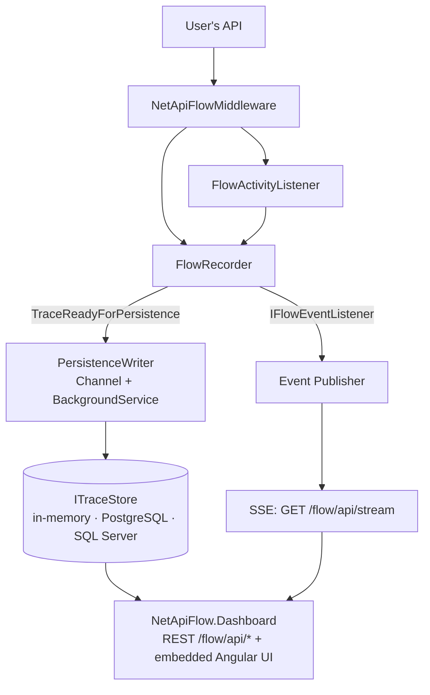

# Architecture

NetApiFlow instruments a request once, at the ASP.NET Core middleware pipeline, and fans the
result out to two independent consumers: a persistent store and a live SSE stream. Neither
consumer blocks the request thread.

## Components

- **`NetApiFlowMiddleware`**: opens a `FlowTrace` per request via `FlowRecorder`, closes it when
  the response finishes. Decides whether a route is traced via `IncludePaths`/`ExcludePaths`
  (route glob matching, D-08).
- **`FlowActivityListener`**: bridges `System.Diagnostics.Activity` into `FlowRecorder`. Every
  `NetApiFlow.Step(...)` call becomes an `Activity`; this listener is the only place that decides,
  per span, whether to record it (`ActivityListener.Sample`, risco R-05). No OpenTelemetry SDK
  dependency — see [ADR-0002](adr/0002-activitysource-nativo-sem-otel-sdk.md). When
  `ExternalSources` is enabled, it also observes `HttpClient`'s own `ActivitySource` and maps
  outbound calls to a sanitized `Http` span — see [ADR-0012](adr/0012-ingestao-httpclient-via-activitysource-externo.md).
- **`FlowRecorder`**: in-memory state of every active and recently-completed trace. The single
  source of truth both the dashboard's live view and the persistence path read from.
- **`PersistenceWriter`**: a `BackgroundService` draining a bounded `Channel` of completed traces.
  Nothing calls `ITraceStore.SaveAsync` from the request thread — persistence I/O never adds
  request latency.
- **Event Publisher** (`IFlowEventListener`, `SseBroadcaster`): turns the same completed-trace and
  span events into the wire format served by `GET /flow/api/stream` (seção 2 do contrato).
- **`ITraceStore`**: the one interface every storage package implements. Default is in-memory;
  `NetApiFlow.Storage.PostgreSql` and `NetApiFlow.Storage.SqlServer` persist the same shape via
  raw ADO.NET — see [ADR-0004](adr/0004-storages-ado-net-direto.md).
- **`NetApiFlow.Dashboard`**: REST + SSE API under `{basePath}/api`, and the compiled Angular
  client served from the same assembly, embedded as a manifest resource — see
  [ADR-0005](adr/0005-dashboard-angular-embutido.md). Access is gated outside Development unless
  `RequireAuthorization` or `IDashboardAuthorizationFilter` is configured — see
  [ADR-0006](adr/0006-dashboard-restrito-a-development.md).

## Cross-cutting decisions

- Every public package multi-targets `net8.0` and `net10.0` — see
  [ADR-0003](adr/0003-multi-targeting-net8-net10.md).
- No span, trace or log ever captures a request/response body, argument, header or query string;
  routes are always recorded as templates — see [ADR-0007](adr/0007-nunca-capturar-payload.md).
- Gitflow and SemVer govern branching and releases — see
  [ADR-0001](adr/0001-gitflow-e-semver.md).

See `docs/adr/` for the full list, and `docs/plano/contratos.md` for the frozen public surface of
every package.
