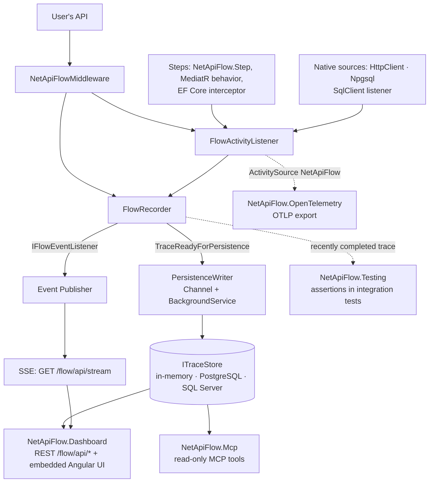

# Architecture

NetApiFlow instruments a request once, at the ASP.NET Core middleware pipeline, and fans the
result out to two independent consumers: a persistent store and a live SSE stream. Neither
consumer blocks the request thread.

## Components

- **`NetApiFlowMiddleware`**: opens a `FlowTrace` per request via `FlowRecorder`, closes it when
  the response finishes. Decides whether a route is traced via `IncludePaths`/`ExcludePaths`
  (route glob matching).
- **`FlowActivityListener`**: bridges `System.Diagnostics.Activity` into `FlowRecorder`. Every
  `NetApiFlow.Step(...)` call becomes an `Activity`; this listener is the only place that decides,
  per span, whether to record it (`ActivityListener.Sample`). It takes no OpenTelemetry SDK
  dependency (see [ADR-0002](adr/0002-activitysource-nativo-sem-otel-sdk.md)). When
  `ExternalSources` is enabled, it also observes `HttpClient`'s own `ActivitySource` and maps
  outbound calls to a sanitized `Http` span (see [ADR-0012](adr/0012-ingestao-httpclient-via-activitysource-externo.md)).
  It does the same for the `"Npgsql"` source, mapped to a `Database` span.
- **`FlowRecorder`**: in-memory state of every active and recently-completed trace. The single
  source of truth both the dashboard's live view and the persistence path read from.
- **`PersistenceWriter`**: a `BackgroundService` draining a bounded `Channel` of completed traces.
  Nothing calls `ITraceStore.SaveAsync` from the request thread, so persistence I/O never adds
  request latency.
- **Event Publisher** (`IFlowEventListener`, `SseBroadcaster`): turns the same completed-trace and
  span events into the wire format served by `GET /flow/api/stream`.
- **`ITraceStore`**: the one interface every storage package implements. Default is in-memory;
  `NetApiFlow.Storage.PostgreSql` and `NetApiFlow.Storage.SqlServer` persist the same shape via
  raw ADO.NET (see [ADR-0004](adr/0004-storages-ado-net-direto.md)).
- **`NetApiFlow.EntityFrameworkCore`**: `FlowDbCommandInterceptor`, a `DbCommandInterceptor` that
  opens a `Database` step with component `EntityFrameworkCore` for each command. EF Core has no
  global interceptor registration, so it is attached to each `DbContext` by the application. The
  package requires EF Core 9 or later, on `net8.0` as well.
- **`NetApiFlow.MediatR`**: `FlowTrackingBehavior<TRequest, TResponse>`, an `IPipelineBehavior`
  that opens a `UseCase` step named after the request type, with operation `Handle`.
- **Native SQL sources** (`ExternalSources`): `Npgsql` is read from its own `ActivitySource` by
  `FlowActivityListener`. `Microsoft.Data.SqlClient` publishes only a `DiagnosticListener`, so
  `SqlClientCommandListener` reads its events, and only from driver version 6.0 on. The listener
  is always registered but subscribes only when the resolved options include `SqlClient`, decided
  by a hosted service at host start, so a value from the Development default or from
  configuration counts, not only one set in code. In `Development` the three sources are on by
  default. A driver command is recorded as a child of the step that issued it, and dropped only
  when the immediately enclosing step is a NetApiFlow `Database` step (`ExistingDatabaseStep`),
  which is what the EF Core interceptor opens, so a command is never recorded twice. See
  [ADR-0018](adr/0018-ingestao-npgsql-dedup-por-parent.md) and
  [ADR-0024](adr/0024-descarte-de-comando-sql-so-por-step-de-banco.md).
- **Pre-pipeline steps and log correlation**: both are decided from the resolved options, never
  from the `AddNetApiFlow` lambda alone. `FlowResourceFilter` is added to MVC's filters by a
  `FlowResourceFilterMvcOptionsSetup` only when `CapturePrePipelineSteps` is on, and
  `FlowAuthorizationFilterListener` subscribes only then. `FlowLoggerProvider` is always
  registered, and its logger records nothing unless `LogCorrelation.Enabled` is on.
- **Route key**: each stored trace keeps `route_template` as recorded, for display, and a
  `route_key`, the same template reduced by `RouteTemplateNormalizer.NormalizeForComparison`
  (constraints and optional or catch-all markers removed, so `/api/orders/{id:int}` and
  `/api/orders/{id}` are one route). `ITraceStore.GetArchitectureMapAsync` and
  `GetLastSuccessfulAsync` take a `routeKey`, and both SQL stores index `(method, route_key)`.
- **`NetApiFlow.OpenTelemetry`**: `AddNetApiFlowOtlpExport` registers a `TracerProvider` that
  observes the `"NetApiFlow"` `ActivitySource` (and `"System.Net.Http"` when asked) and exports it
  over OTLP. The OpenTelemetry SDK samples independently of `FlowActivityListener`, so the
  exported volume can exceed what the dashboard shows.
- **`NetApiFlow.Testing`**: `GetFlowTrace` reads the `X-NetApiFlow-TraceId` header off a response
  and returns the trace from the recorder's recently-completed buffer, and assertions such as
  `ShouldHaveNoErrors`, `ShouldCallAtMost`, `ShouldNeverCall` and `ShouldHaveCalled` run on it.
  It references only the core and the framework, so it imposes no assertion library on the
  test project.
- **`NetApiFlow.Dashboard`**: REST + SSE API under `{basePath}/api`, and the compiled Angular
  client served from the same assembly, embedded as a manifest resource (see
  [ADR-0005](adr/0005-dashboard-angular-embutido.md)). Access is gated outside Development unless
  `RequireAuthorization` or `IFlowAccessFilter` is configured (see
  [ADR-0006](adr/0006-dashboard-restrito-a-development.md)).
- **`NetApiFlow.Mcp`**: three read-only MCP tools over the same `ITraceStore`, no dependency on
  `NetApiFlow.Dashboard` (see [ADR-0013](adr/0013-servidor-mcp-somente-leitura.md)). It shares the
  dashboard's access gate via `IFlowAccessFilter` in the core, instead of duplicating it (see
  [ADR-0015](adr/0015-filtro-de-acesso-unico-no-nucleo.md)).

## Cross-cutting decisions

- Every public package multi-targets `net8.0` and `net10.0` (see
  [ADR-0003](adr/0003-multi-targeting-net8-net10.md)).
- No span, trace or log ever captures a request/response body, argument, header or query string;
  routes are always recorded as templates (see [ADR-0007](adr/0007-nunca-capturar-payload.md)).
- Gitflow and SemVer govern branching and releases (see
  [ADR-0001](adr/0001-gitflow-e-semver.md)).

See `docs/adr/` for the full list, and `docs/plano/contratos.md` for the frozen public surface of
every package.
